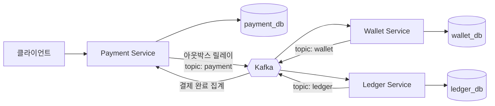

# payment-system

장애·메시지 유실·동시성이 있는 상태에서도 돈이 맞아떨어지는 결제 시스템을 직접 만들어 보는 실험실.

자금 흐름은 세 단계다.

```text
결제 처리 → 잔액 정산 → 장부 기록
```

`distributed-transaction-*` 실험실이 "부분 커밋을 어떻게 막을까"를 다뤘다면, 여기서는 애초에 전체를 하나의 트랜잭션으로 묶지 않는다. 각 서비스가 로컬 트랜잭션만 쓰고, 그 사이를 Kafka 이벤트와 재시도로 잇는다. 중간이 깨져도 최종적으로 상태가 수렴하는 쪽을 택한다.

> 시각 자료로 정리한 요약은 [`overview.html`](overview.html)에 있다. 내려받아 브라우저로 열면 흐름 다이어그램·상태 머신·면접 Q&A를 볼 수 있다.

## 구성



| 서비스 | 책임 | 스택 | Gradle 프로젝트 | 포트 |
| --- | --- | --- | --- | ---: |
| Payment | 결제 요청 수락, PSP(Toss) 승인 호출, 실패 재시도, 아웃박스 발행, 완료 집계 | WebFlux, R2DBC, Spring Cloud Stream(Reactive Kafka) | `:payment-system-payment-service` | 8090 |
| Wallet | 결제 결과를 받아 판매자 지갑 잔액 정산 | Spring MVC, JPA, Spring Cloud Stream(Kafka) | `:payment-system-wallet-service` | 8091 |
| Ledger | 복식부기 장부 기록 | Spring MVC, JPA, Spring Cloud Stream(Kafka) | `:payment-system-ledger-service` | 8092 |

서비스는 다른 서비스의 테이블을 직접 읽거나 쓰지 않는다. Payment가 자기 DB에 커밋한 사실을 이벤트로 알리고, Wallet과 Ledger가 각자 받아서 처리한 뒤 결과를 다시 이벤트로 돌려준다.

## 결제 흐름

1. **Checkout** — `CheckoutService`가 요청으로 멱등 키(`IdempotencyCreator`)를 만들어 `orderId`로 쓰고, `payment_events`·`payment_orders`(`NOT_STARTED`)를 한 트랜잭션에 저장한다.
2. **Confirm** — `PaymentConfirmService`가 주문 행을 `SELECT … FOR UPDATE`로 잠그고 `NOT_STARTED`·`UNKNOWN`에서만 `EXECUTING`으로 넘긴다. 이미 처리 중이거나 끝난 결제는 PSP를 부르지 않고 현재 상태로 응답하고, 없는 `orderId`는 `PAYMENT_NOT_FOUND` 실패로 응답한다. 저장된 금액 합과 요청 금액을 비교한 뒤 `TossPaymentExecutor`로 PSP 승인을 호출한다. `Idempotency-Key: orderId` 헤더를 붙인다.
3. **에러 분류·재시도** — `TossPaymentError`가 응답 코드를 성공·실패·알 수 없음으로 나눈다. 알 수 없음과 타임아웃만 `Retry.backoff(2, 1s).jitter(0.1)`로 재시도하고, 끝까지 실패하면 `PaymentErrorHandler`가 `UNKNOWN`으로 기록한다. `ALREADY_PROCESSED_PAYMENT`는 Toss 결제 조회(`GET /v1/payments/{paymentKey}`)로 확인해 정상 성공으로 바꾸고, 확인이 안 되면 `UNKNOWN`으로 남긴다.
4. **아웃박스** — 성공 시 상태 변경과 `outboxes` INSERT를 한 트랜잭션에서 커밋하고, 커밋 후(`AFTER_COMMIT`) `PaymentEventMessageSender`가 `payment` 토픽으로 발행한다. payload에는 주문 라인(`paymentOrderId`, `sellerId`, `productId`, `amount`)과 `totalAmount`를 싣는다. 파티션은 `orderId` 해시로 고정해 같은 결제는 같은 파티션으로 간다. 발행이 빠진 행은 릴레이가 3분마다 다시 보낸다.
5. **정산** — Wallet이 payload의 주문 라인을 판매자별로 묶어 `@Version` 낙관적 락으로 지갑 잔액을 갱신한다. 충돌하면 최신 값을 다시 읽어 최대 3번 재시도한다(지수 백오프 + 상한 + 지터). 지갑이 없는 판매자가 있으면 실패시켜 DLQ로 보낸다. 중복은 `wallet_transactions.idempotency_key` UNIQUE가 막는다.
6. **장부** — Ledger가 payload의 주문 라인마다 차변(`ITEM_BUYER`)·대변(`REVENUE`) 한 쌍을 만들고, 저장 전에 거래별 차변 합 = 대변 합, 대변 합 = 결제 총액을 확인한다. 중복은 `ledger_transactions.idempotency_key` UNIQUE가 막는다.
7. **완료** — Payment가 `wallet`·`ledger` 결과 이벤트를 받아 자기 플래그를 켜고, 같은 트랜잭션에서 "모든 주문의 두 플래그가 켜졌을 때만" 조건을 단 UPDATE로 `is_payment_done`을 켠다.
8. **복구** — `PaymentScheduler`가 3분마다 `UNKNOWN`이거나 3분 넘게 `EXECUTING`에 머문 결제를 결제 단위로 10건씩 가져와, `EXECUTING`으로 선점한 뒤 다시 승인한다.

## 다룰 주제와 현재 구현 상태

| 주제 | 어디서 | 무엇을 재현하나 | 상태 |
| --- | --- | --- | --- |
| 트랜잭셔널 아웃박스 | Payment | 커밋은 됐는데 이벤트 발행이 실패하는 창(window)을 없앤다 | 구현. 커밋 후 발행 + 릴레이(`PaymentEventMessageRelayService`)가 `PaymentScheduler`로 3분마다 돈다 |
| 결제 재시도 | Payment | 실패한 결제를 재시도해 최종적으로 완료 상태로 보낸다 | 구현(PSP 호출 재시도, 복구 `PaymentRecoveryService`가 `PaymentScheduler`로 3분마다 돈다) |
| 낙관적 락 | Wallet | 같은 지갑에 정산이 동시에 몰릴 때의 Lost Update | 구현(`JpaWalletRepository`, 지수 백오프 `OptimisticLockRetryBackoff`, `JpaWalletRepositoryTest`) |
| 순서 보장 | Kafka | 같은 결제 건의 이벤트가 뒤바뀌어 처리되는 경우 | 일부. 같은 `orderId`를 같은 파티션으로 보내는 것까지 |
| 복식부기 | Ledger | 차변·대변 합이 0이 아니면 커밋되지 않게 한다 | 구현. 저장 전에 거래별 차변 합 = 대변 합, 대변 합 = 결제 총액을 도메인(`Ledger.verifyBalanced`)과 어댑터에서 확인한다 |
| 불변 장부 | Ledger | DB 트리거로 `UPDATE`·`DELETE`를 막아 append-only를 강제한다 | 구현. `spring.sql.init.mode: always`로 기동 때 트리거를 건다. 테스트로 거부를 확인한다 |
| Retry Queue / DLQ | Wallet, Ledger, Payment | 소비 실패한 메시지를 유실하지 않고 재시도·격리한다 | 바인더 설정(`max-attempts: 5`, `enable-dlq`). 실패 메시지가 DLQ로 가는 것은 테스트로 확인했다. DLQ를 소비·재처리하는 코드는 없다 |
| Bulkhead | Payment | 한 PSP가 느려질 때 다른 결제까지 같이 죽지 않게 막는다 | 미구현 |
| Reconciliation | 전체 | 서비스 간 데이터가 어긋났을 때 대조로 찾아내고 복구한다 | 미구현 |

## 패키지 구조

세 서비스 모두 헥사고날(포트·어댑터) 구조를 쓴다.

```text
dev.deepdive.paymentsystem.{payment,wallet,ledger}
├── adapter
│   ├── in             # web(컨트롤러), stream(Kafka 컨슈머), scheduler(복구·릴레이, payment)
│   └── out            # persistent·persistence(DB), stream(Kafka 프로듀서), web(PSP·상품 조회)
├── application
│   ├── port/in        # 유스케이스 인터페이스
│   ├── port/out       # 외부 의존 인터페이스
│   ├── exception      # 어댑터가 던지고 서비스가 해석하는 예외
│   └── service        # 유스케이스 구현
├── domain             # 엔티티와 도메인 규칙
└── common             # @UseCase, @PersistentAdapter 같은 스테레오타입
```

payment 서비스의 `common`은 `dev.deepdive.paymentsystem.common`에 있고, wallet·ledger는 각자 `{wallet,ledger}.common` 아래에 있다.

## 실행

테스트는 Testcontainers로 MySQL(`mysql:8.0.36`)과 Kafka(`apache/kafka:3.8.1`)를 직접 띄운다. 로컬에 MySQL·Kafka를 따로 띄울 필요는 없고 **Docker만 있으면 된다**. 기본 `test`(CI 포함)에서 돈다.

```bash
./gradlew :payment-system-payment-service:test
./gradlew :payment-system-wallet-service:test
./gradlew :payment-system-ledger-service:test
```

- 서비스마다 싱글톤 컨테이너 기반 클래스(`PaymentIntegrationTestSupport`, `WalletIntegrationTestSupport`, `LedgerIntegrationTestSupport`)가 있고, `@DynamicPropertySource`로 접속 정보를 넣는다. 바인더가 `auto-create-topics: false`라 토픽은 기반 클래스가 미리 만든다.
- payment 테스트는 `payment.scheduler.enabled=false`로 스케줄러를 끄고 유스케이스를 직접 호출한다.
- ledger 테이블은 DELETE 금지 트리거가 있어 비울 수 없다. 테스트마다 새 `orderId`를 쓰고 그 `orderId`로만 확인한다. 트리거를 만들려고 MySQL 컨테이너에 `--log-bin-trust-function-creators=1`을 준다.
- 실제 Toss 테스트 서버를 부르는 `TossPaymentExecutorTest`만 `@Tag("ExternalIntegration")`으로 빠진다. 포함하려면 `-PincludeIntegration`을 준다.

애플리케이션으로 직접 띄우려면 `application` 플러그인의 `run`을 쓴다. 이때는 `application.yml`이 기대하는 MySQL과 Kafka가 로컬에 있어야 한다. 스키마는 세 서비스 모두 기동 때 `schema.sql`을 적용한다(`spring.sql.init.mode: always`, 멱등 DDL). Hibernate는 `validate`만 한다. 토픽 자동 생성이 꺼져 있으므로 `payment`(파티션 6), `wallet`, `ledger`와 DLQ 토픽을 미리 만든다. 바인더는 DLQ에도 원래 레코드와 같은 파티션 번호로 보내므로 `payment_wallet_dlq`·`payment_ledger_dlq`는 `payment`와 같은 6개 파티션이어야 한다.

```bash
./gradlew :payment-system-payment-service:run
```

접속 정보는 환경 변수로 덮어쓸 수 있다.

| 변수 | 서비스 |
| --- | --- |
| `PAYMENT_DB_URL`, `PAYMENT_DB_USERNAME`, `PAYMENT_DB_PASSWORD` | Payment |
| `WALLET_DB_URL`, `WALLET_DB_USERNAME`, `WALLET_DB_PASSWORD` | Wallet |
| `LEDGER_DB_URL`, `LEDGER_DB_USERNAME`, `LEDGER_DB_PASSWORD` | Ledger |
| `KAFKA_BROKERS` | 전체 |
| `TOSS_BASE_URL`, `TOSS_SECRET_KEY` | Payment |
| `PAYMENT_SCHEDULER_ENABLED` | Payment (복구·릴레이 스케줄러, 기본 `true`) |

## 현재 상태

Checkout → Confirm(PSP 호출·에러 분류·재시도) → 아웃박스 발행 → 지갑 정산 → 장부 기록 → 결제 완료 집계, 그리고 복구·릴레이 스케줄러까지 한 바퀴가 돈다. 처음 정리한 "알려진 문제"는 아래처럼 고쳤고, 세 서비스 테스트가 Testcontainers로 CI에서 돈다.

### 고친 것

- **스케줄러가 돌지 않던 문제.** `@Profile("dev")`를 없애고 인바운드 어댑터 `adapter/in/scheduler/PaymentScheduler`(`@EnableScheduling`)가 복구·릴레이를 3분마다 부른다. `payment.scheduler.enabled`(기본 `true`)로 끈다. 유스케이스는 `Mono`를 돌려주고 스케줄러가 끝날 때까지 기다려 회차가 겹치지 않는다.
- **`ALREADY_PROCESSED_PAYMENT` 처리.** `TossPaymentExecutor`가 Toss 결제 조회(`GET /v1/payments/{paymentKey}`, 승인과 같은 Basic 인증)로 결제를 확인하고, `orderId`·금액이 같고 `status`가 `DONE`일 때만 승인 상세가 있는 정상 성공으로 바꾼다. 조회가 실패하거나 맞지 않으면 `UNKNOWN`으로 남겨 복구에 맡긴다. 상세 없는 성공 신호가 핸들러까지 와도 예외 대신 `UNKNOWN`으로 기록한다.
- **결제수단·타입.** `PaymentMethod`에 Toss 값 8개(카드·가상계좌·간편결제·휴대폰·계좌이체·문화상품권·도서문화상품권·게임문화상품권), `PaymentType`에 `NORMAL`·`BILLING`·`BRANDPAY`를 넣었다. 모르는 값은 PSP 승인 뒤에 결제를 깨뜨리지 않도록 `UNKNOWN`으로 받고 경고 로그를 남긴다. `CULTURE_GIFT_CERTIFICATE`(24자)가 들어가도록 `payment_events.method`를 `VARCHAR(50)`으로 넓혔다(기존 DB도 `ALTER … MODIFY`로 넓힌다).
- **복구 대상 조회.** 주문 행이 아니라 결제(`payment_event_id`) 단위로 정렬해 10건을 고른 뒤 그 결제의 주문을 전부 붙인다. 한 결제의 주문이 잘려 금액 검증이 FAILURE로 끝나던 문제가 없어졌다. 시각 비교는 DB 시계(`NOW()`)로 한다.
- **결제 완료 레이스.** 자기 플래그 UPDATE와 "모든 주문의 두 플래그가 켜졌을 때만" 조건을 단 `is_payment_done` UPDATE를 한 트랜잭션에서 실행한다. 메모리에서 판단하던 read-modify-write를 없앴다.
- **최종 상태 덮어쓰기.** 모든 상태 전이가 주문 행을 `SELECT … FOR UPDATE`로 잠그고 이전 상태를 확인한 뒤 `WHERE payment_order_status IN (…)` 조건부 UPDATE를 한다. 최종 상태는 `EXECUTING`·`UNKNOWN`에서만 기록하고, 이미 `SUCCESS`·`FAILURE`면 덮어쓰지 않고 현재 상태로 응답한다.
- **동시 confirm.** confirm은 `NOT_STARTED`·`UNKNOWN`에서만 `EXECUTING`으로 선점한다. 다른 요청이 처리 중이면 PSP를 부르지 않고 `EXECUTING`("결제가 이미 처리 중입니다.")으로 응답한다. 멈춘 `EXECUTING`은 사용자 재요청이 아니라 복구가 3분 뒤 선점해 이어받는다.
- **없는 `orderId`.** 주문이 없으면 DB에 쓰지 않고 `PAYMENT_NOT_FOUND` 실패로 응답한다(예전에는 `SUM` NULL → NPE → `UNKNOWN`).
- **Wallet·Ledger가 읽던 빈 `payment_orders`.** Event-Carried State Transfer로 바꿨다. 아웃박스 payload에 주문 라인과 `totalAmount`를 싣고(metadata `payloadVersion: 2`), Wallet·Ledger는 payload만 읽는다. 두 서비스의 `payment_orders` 테이블·엔티티·포트는 지웠다.
- **소비자 멱등성.** `wallet_transactions`·`ledger_transactions`의 `idempotency_key`에 UNIQUE를 걸었다(schema + JPA). 키는 `orderId`·참조 종류·참조 id(지갑은 거래 방향까지)로 만든다. 같은 메시지가 동시에 들어와도 늦은 쪽은 UNIQUE 위반으로 롤백되고 "이미 처리됨" 성공으로 응답한다. INSERT는 키 순으로 정렬하고, 교착으로 희생된 트랜잭션은 다시 시도한다.
- **지갑 없는 판매자.** 조용히 건너뛰지 않고 `WalletNotFoundException`으로 처리 전체를 실패시킨다. 메시지는 재시도 후 DLQ로 간다.
- **형식적인 복식부기 검사.** `DoubleLedgerEntry`가 방향·양수·계정까지 확인하고, 저장 전에 거래별 차변 합 = 대변 합, 배치 안 거래 중복 없음, 대변 합 = 결제 총액을 확인한다. 어댑터도 매핑된 JPA 행으로 거래별 합을 다시 본다.
- **낙관적 락 재시도 대기.** `Thread.sleep(random × 100ms)`를 지수 백오프(50ms부터, 상한 1초) + equal jitter로 바꿨다. 총 시도는 1 + `MAX_RETRIES`(3) 그대로다. 지갑을 id 순으로 정렬해 동시 정산끼리의 교착도 없앴다.
- **헥사고날 의존 방향.** 애플리케이션 계층이 쓰는 예외를 `application/exception`으로, `PaymentEventMessagePublisher`를 domain에서 `adapter/out/stream`으로 옮겼다.
- **스키마 적용.** 세 서비스 모두 `spring.sql.init.mode: always`로 `schema.sql`을 기동 때 적용하고 Hibernate는 `validate`다. Ledger 트리거가 자동으로 걸린다.
- **테스트.** Testcontainers 기반으로 바꾸고 태그를 뗐다. sleep만 하던 테스트에 결과 assert(Awaitility)를 넣고, 동시성(완료 집계, 중복 confirm, 소비자 중복)과 단위(PSP 응답 매핑, 결제수단, 없는 주문, 복식부기, 백오프, 스케줄러) 테스트를 더했다.

고치면서 함께 드러난 것도 고쳤다.

- **Kafka 바인딩이 하나도 생기지 않았다.** payment의 `spring.cloud.stream.function.definition`은 Spring Cloud Stream 4.x가 읽지 않는 키라 발행도 완료 이벤트 소비도 되지 않았다. `spring.cloud.function.definition`으로 바꿨다.
- 이력 INSERT를 문자열로 이어 붙여, 따옴표가 든 Toss 실패 메시지(`INCORRECT_BASIC_AUTH_FORMAT`)에서 SQL 오류가 났다. 바인딩으로 바꿨다.
- 발행 싱크가 `FAIL_FAST`라 동시에 `emitNext`하면 `FAIL_NON_SERIALIZED`로 발행이 빠질 수 있었다. `busyLooping`으로 바꿨다.

### 가정과 호환성

- Toss 결제 조회 응답은 승인 응답과 같은 Payment 객체라고 보고 같은 응답 레코드(`TossPaymentConfirmationResponse`)를 쓴다. Toss 문서에 기댄 가정이다.
- 결제 이벤트 payload가 바뀌었다(v1: `{orderId}` → v2: `{orderId, paymentKey, totalAmount, paymentOrders[]}`). Wallet·Ledger는 v1 메시지를 처리하지 못하고 재시도 후 DLQ로 보낸다. 배포는 Payment를 먼저 올리고, 이미 쌓인 v1 아웃박스 행은 주문 라인을 붙여 다시 발행해야 한다. 메시지 형식을 더 바꿀 때는 `metadata.payloadVersion`으로 구분한다.
- UNIQUE 제약은 `CREATE TABLE IF NOT EXISTS` 안에 있어 이미 만들어진 로컬 Wallet·Ledger 테이블에는 붙지 않는다. 예전 스키마로 만든 로컬 DB는 지우고 다시 띄운다.

### 알려진 문제

- **threshold를 넘긴 결제는 `UNKNOWN`으로 남는다.** `failed_count`가 `threshold`(5)에 닿으면 복구 대상에서 빠지고 알림이나 수동 검토 경로가 없다.
- **복구는 재승인부터 한다.** PSP 조회는 `ALREADY_PROCESSED_PAYMENT` 응답일 때만 한다. 가상계좌처럼 승인 응답이 `DONE`이 아닌 경우(`WAITING_FOR_DEPOSIT`)도 따로 다루지 않는다.
- **DLQ 재처리, Bulkhead, Reconciliation은 아직 없다.**
- **Kafka 트랜잭션과 DB 트랜잭션이 따로다.** Wallet·Ledger는 DB 커밋 뒤 결과를 발행하므로 발행 실패 시 재전달과 멱등성에 기댄다.
- **payment의 리액티브 소비자에는 바인더 재시도·DLQ가 기대대로 적용되지 않을 수 있다.** 요소별 에러 처리가 없다.
- **SUCCESS 시 아웃박스·이벤트를 쓰는 흐름이 영속 어댑터 안에 있다.** ArchUnit 같은 의존 규칙 테스트도 없다.
