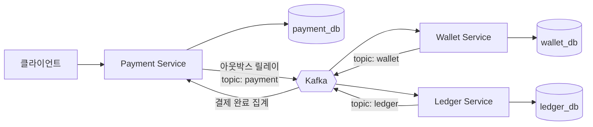

# payment-system

장애·메시지 유실·동시성이 있는 상태에서도 돈이 맞아떨어지는 결제 시스템을 직접 만들어 보는 실험실.

자금 흐름은 세 단계다.

```text
결제 처리 → 잔액 정산 → 장부 기록
```

`distributed-transaction-*` 실험실이 "부분 커밋을 어떻게 막을까"를 다뤘다면, 여기서는 애초에 전체를 하나의 트랜잭션으로 묶지 않는다. 각 서비스가 로컬 트랜잭션만 쓰고, 그 사이를 Kafka 이벤트와 재시도로 잇는다. 중간이 깨져도 최종적으로 상태가 수렴하는 쪽을 택한다.

> 시각 자료로 정리한 요약은 [`overview.html`](overview.html)에 있다. 내려받아 브라우저로 열면 흐름 다이어그램·상태 머신·면접 Q&A를 볼 수 있다.

## 구성



| 서비스 | 책임 | 스택 | Gradle 프로젝트 | 포트 |
| --- | --- | --- | --- | ---: |
| Payment | 결제 요청 수락, PSP(Toss) 승인 호출, 실패 재시도, 아웃박스 발행, 완료 집계 | WebFlux, R2DBC, Spring Cloud Stream(Reactive Kafka) | `:payment-system-payment-service` | 8090 |
| Wallet | 결제 결과를 받아 판매자 지갑 잔액 정산 | Spring MVC, JPA, Spring Cloud Stream(Kafka) | `:payment-system-wallet-service` | 8091 |
| Ledger | 복식부기 장부 기록 | Spring MVC, JPA, Spring Cloud Stream(Kafka) | `:payment-system-ledger-service` | 8092 |

서비스는 다른 서비스의 테이블을 직접 읽거나 쓰지 않는다. Payment가 자기 DB에 커밋한 사실을 이벤트로 알리고, Wallet과 Ledger가 각자 받아서 처리한 뒤 결과를 다시 이벤트로 돌려준다.

## 결제 흐름

1. **Checkout** — `CheckoutService`가 요청으로 멱등 키(`IdempotencyCreator`)를 만들어 `orderId`로 쓰고, `payment_events`·`payment_orders`(`NOT_STARTED`)를 한 트랜잭션에 저장한다.
2. **Confirm** — `PaymentConfirmService`가 상태를 `EXECUTING`으로 바꾸고, 저장된 금액 합과 요청 금액을 비교한 뒤 `TossPaymentExecutor`로 PSP 승인을 호출한다. `Idempotency-Key: orderId` 헤더를 붙인다.
3. **에러 분류·재시도** — `TossPaymentError`가 응답 코드를 성공·실패·알 수 없음으로 나눈다. 알 수 없음과 타임아웃만 `Retry.backoff(2, 1s).jitter(0.1)`로 재시도하고, 끝까지 실패하면 `PaymentErrorHandler`가 `UNKNOWN`으로 기록한다.
4. **아웃박스** — 성공 시 상태 변경과 `outboxes` INSERT를 한 트랜잭션에서 커밋하고, 커밋 후(`AFTER_COMMIT`) `PaymentEventMessageSender`가 `payment` 토픽으로 발행한다. 파티션은 `orderId` 해시로 고정해 같은 결제는 같은 파티션으로 간다.
5. **정산** — Wallet이 `orderId`로 중복을 거른 뒤, `@Version` 낙관적 락으로 지갑 잔액을 갱신한다. 충돌하면 최신 값을 다시 읽어 최대 3번 재시도한다.
6. **장부** — Ledger가 주문마다 차변(`ITEM_BUYER`)·대변(`REVENUE`) 한 쌍을 기록한다.
7. **완료** — Payment가 `wallet`·`ledger` 결과 이벤트를 받아 두 쪽이 모두 끝나면 `is_payment_done`을 켠다.

## 다룰 주제와 현재 구현 상태

| 주제 | 어디서 | 무엇을 재현하나 | 상태 |
| --- | --- | --- | --- |
| 트랜잭셔널 아웃박스 | Payment | 커밋은 됐는데 이벤트 발행이 실패하는 창(window)을 없앤다 | 구현. 발행 실패분을 다시 보내는 릴레이(`PaymentEventMessageRelayService`)는 아래 "알려진 문제" 참고 |
| 결제 재시도 | Payment | 실패한 결제를 재시도해 최종적으로 완료 상태로 보낸다 | 구현(PSP 호출 재시도, 복구 스케줄러 `PaymentRecoveryService`). 스케줄러 활성화는 아래 참고 |
| 낙관적 락 | Wallet | 같은 지갑에 정산이 동시에 몰릴 때의 Lost Update | 구현(`JpaWalletRepository`, `JpaWalletRepositoryTest`) |
| 순서 보장 | Kafka | 같은 결제 건의 이벤트가 뒤바뀌어 처리되는 경우 | 일부. 같은 `orderId`를 같은 파티션으로 보내는 것까지 |
| 복식부기 | Ledger | 차변·대변 합이 0이 아니면 커밋되지 않게 한다 | 일부. 엔트리 한 쌍의 금액이 같은지만 도메인에서 확인한다 |
| 불변 장부 | Ledger | DB 트리거로 `UPDATE`·`DELETE`를 막아 append-only를 강제한다 | DDL만 있음(`ledger-service/src/main/resources/schema.sql`). 자동 적용 설정은 없다 |
| Retry Queue / DLQ | Wallet, Ledger, Payment | 소비 실패한 메시지를 유실하지 않고 재시도·격리한다 | 바인더 설정만 있음(`max-attempts: 5`, `enable-dlq`). DLQ를 소비·재처리하는 코드는 없다 |
| Bulkhead | Payment | 한 PSP가 느려질 때 다른 결제까지 같이 죽지 않게 막는다 | 미구현 |
| Reconciliation | 전체 | 서비스 간 데이터가 어긋났을 때 대조로 찾아내고 복구한다 | 미구현 |

## 패키지 구조

세 서비스 모두 헥사고날(포트·어댑터) 구조를 쓴다.

```text
dev.deepdive.paymentsystem.{payment,wallet,ledger}
├── adapter
│   ├── in             # web(컨트롤러), stream(Kafka 컨슈머)
│   └── out            # persistent·persistence(DB), stream(Kafka 프로듀서), web(PSP·상품 조회)
├── application
│   ├── port/in        # 유스케이스 인터페이스
│   ├── port/out       # 외부 의존 인터페이스
│   └── service        # 유스케이스 구현
├── domain             # 엔티티와 도메인 규칙
└── common             # @UseCase, @PersistentAdapter 같은 스테레오타입
```

payment 서비스의 `common`은 `dev.deepdive.paymentsystem.common`에 있고, wallet·ledger는 각자 `{wallet,ledger}.common` 아래에 있다.

## 실행

테스트는 모두 `@Tag("ExternalIntegration")`이 붙어 있고, 로컬 MySQL과 Kafka(`localhost:9092`)가 떠 있어야 돈다. 그래서 기본 `test`(CI 포함)에서는 제외되고, `-PincludeIntegration`을 줘야 포함된다.

```bash
./gradlew :payment-system-payment-service:test -PincludeIntegration
./gradlew :payment-system-wallet-service:test -PincludeIntegration
./gradlew :payment-system-ledger-service:test -PincludeIntegration
```

애플리케이션으로 직접 띄우려면 `application` 플러그인의 `run`을 쓴다. 이때도 `application.yml`이 기대하는 MySQL과 Kafka가 로컬에 있어야 한다.

```bash
./gradlew :payment-system-payment-service:run
```

접속 정보는 환경 변수로 덮어쓸 수 있다.

| 변수 | 서비스 |
| --- | --- |
| `PAYMENT_DB_URL`, `PAYMENT_DB_USERNAME`, `PAYMENT_DB_PASSWORD` | Payment |
| `WALLET_DB_URL`, `WALLET_DB_USERNAME`, `WALLET_DB_PASSWORD` | Wallet |
| `LEDGER_DB_URL`, `LEDGER_DB_USERNAME`, `LEDGER_DB_PASSWORD` | Ledger |
| `KAFKA_BROKERS` | 전체 |
| `TOSS_BASE_URL`, `TOSS_SECRET_KEY` | Payment |

## 현재 상태

Checkout → Confirm(PSP 호출·에러 분류·재시도) → 아웃박스 발행 → 지갑 정산 → 장부 기록 → 결제 완료 집계까지 한 바퀴가 구현돼 있다.

### 알려진 문제

코드에서 확인한 것이고, 하나씩 고쳐 나갈 목록이다.

- **스케줄러가 돌지 않는다.** `PaymentRecoveryService`와 `PaymentEventMessageRelayService`는 `@Profile("dev")`인데 dev 프로파일을 켜는 설정이 없고, `@EnableScheduling`도 없다. 그래서 `UNKNOWN` 결제 복구와 아웃박스 재발행이 실제로는 실행되지 않는다.
- **`ALREADY_PROCESSED_PAYMENT` 응답을 처리하지 못한다.** 이 코드는 성공으로 분류되지만 `PaymentErrorHandler`가 `extraDetails` 없이 `SUCCESS` 커맨드를 만들어 `PaymentStatusUpdateCommand` 생성자에서 `IllegalArgumentException`이 난다.
- **결제 수단이 `EASY_PAY`(간편결제)뿐이다.** `PaymentMethod`에 없는 수단이 오면 PSP 승인 후 매핑에서 `IllegalStateException`이 난다.
- **복구 대상 조회가 주문 행 단위로 `LIMIT 10`이다.** 한 결제의 주문 일부만 잘려 들어오면 금액 검증이 어긋날 수 있다.
- **Wallet·Ledger가 읽는 `payment_orders`를 채우는 코드가 없다.** 두 서비스는 자기 DB의 `payment_orders`에서 금액을 조회하지만, 이 테이블에 쓰는 코드는 어디에도 없다.
- **Wallet·Ledger 중복 처리는 조회 후 저장(check-then-act)이다.** `existsByOrderId`로 확인한 뒤 저장하고, `idempotency_key`에 UNIQUE 제약은 없다.
- **CI에서 이 모듈의 테스트는 실행되지 않는다.** 위 "실행" 참고. `payment-service/build.gradle`에 Testcontainers 의존성은 있지만 아직 쓰는 테스트는 없다.
