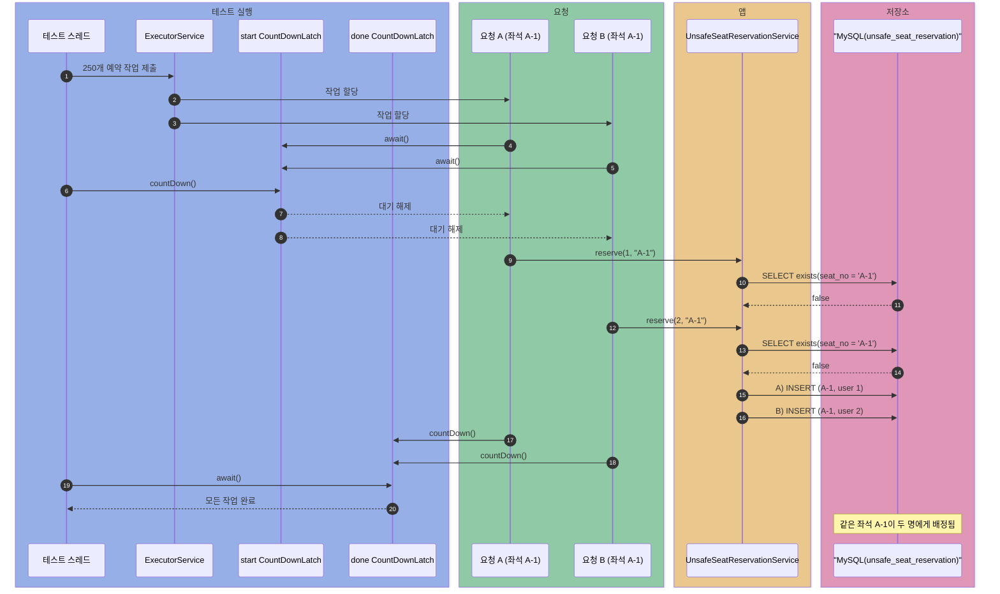
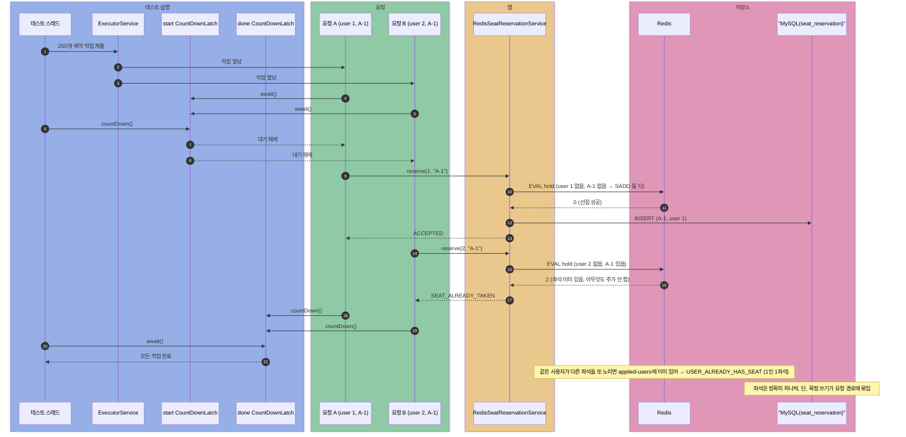
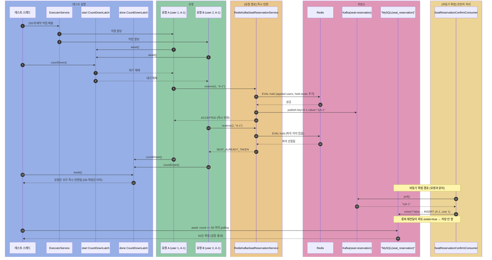
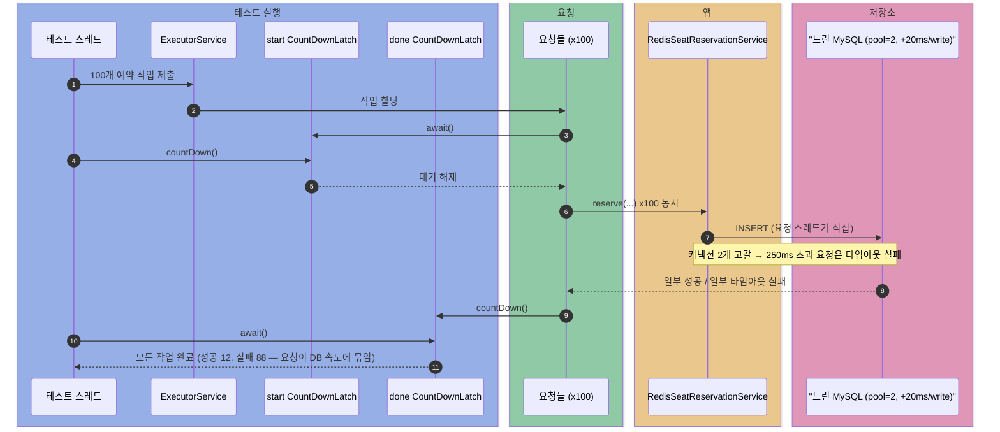
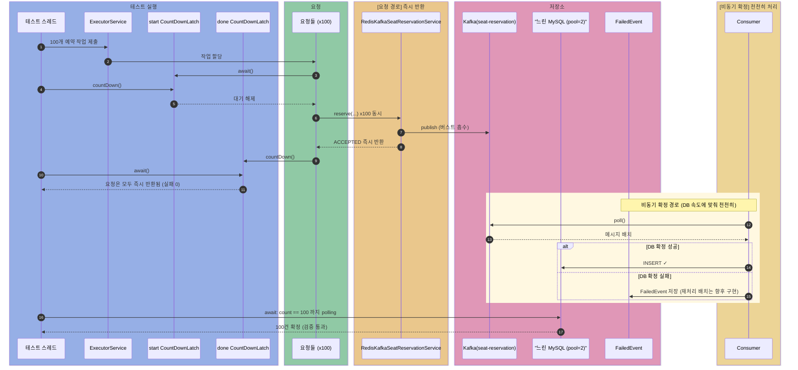

# seat-reservation

콘서트 좌석 예약에서 같은 좌석을 여러 명이 동시에 노릴 때 생기는 동시성 문제와,
예약이 한꺼번에 몰릴 때 RDB가 병목이 되는 부하 문제를 단계로 쌓아 실험.

두 가지 불변식을 지켜야 한다.

- **이중 배정 금지**: 한 좌석은 한 명에게만 배정
- **1인 1좌석**: 한 사람은 한 좌석만 예약

해결 과정:

1. 동시성 제어 없음 → 같은 좌석이 여러 명에게 배정됨
2. Redis 선점(SADD) → 두 불변식(이중 배정·1인 1좌석)을 보장 (동시성 해결)
3. Redis + Kafka → DB 확정을 요청 경로에서 분리 (결합 문제 해결. 내구성은 커맨드가 브로커에 기록된 뒤부터)
4. 버스트 부하 비교 & 실패 처리 → DB가 병목일 때 Kafka가 몰린 요청을 받아 내고, 확정이 실패해도 FailedEvent로 남긴다 (재처리 배치는 향후 구현)
5. 정합성 보강 → 선점 Lua 원자화, DB 유니크 제약, 확정·전송 실패 시 선점 해제, 깨진 메시지도 FailedEvent로 (아래 "케이스 5" 절)

## 공통 환경

- Testcontainers MySQL 8.0.36 (예약 확정 저장소)
- Redis 케이스: Testcontainers Redis 7.2.5 추가
- Kafka 케이스: Testcontainers Kafka(`apache/kafka:3.8.1`) 추가
- 좌석은 `A-0` ~ `A-49` 50개, 좌석마다 5명이 동시에 노림 → 요청 250개
- 모두 Docker 기반으로 띄우므로 테스트 실행 전 Docker가 떠 있어야 함

## 케이스 1. 동시성 제어 없음

흐름:

```text
SELECT 좌석 존재 여부 -> 없으면 INSERT
```

코드 흐름:

비교군은 유니크 제약이 없는 별도 테이블 `unsafe_seat_reservation`(`UnsafeSeatReservation`)에 쓴다.
확정 테이블 `seat_reservation`에는 유니크 제약(케이스 5)이 있어서, 같은 테이블을 쓰면 DB가 중복 INSERT를 막아 이 케이스의 이중 배정을 재현할 수 없기 때문이다.

```java
@Transactional
public SeatReservationRequestResult reserve(long userId, String seatNo) {
    if (unsafeSeatReservationRepository.existsBySeatNo(seatNo)) {
        return new SeatReservationRequestResult(userId, seatNo, SEAT_ALREADY_TAKEN);
    }
    Thread.yield();
    unsafeSeatReservationRepository.save(new UnsafeSeatReservation(seatNo, userId));
    return new SeatReservationRequestResult(userId, seatNo, ACCEPTED);
}
```

결과:

- 기대값: 좌석 50개 → 예약 50건
- 실제 결과: 같은 좌석이 여러 명에게 배정되어 예약이 50건보다 많아짐 (실행 예: 53건)
- 테스트 단언문: `assertThat(reservationCount).isGreaterThan(SEATS)`

이유:

- 같은 좌석을 노린 여러 스레드가 동시에 `existsBySeatNo` 조회 → 아직 아무도 저장 전이라 모두 `false`
- 모두 "빈 좌석"으로 판단하고 각자 `INSERT`
- 같은 좌석이 여러 명에게 배정 (이중 배정)
- 쿠폰의 lost update와 같은 뿌리



## 케이스 2. Redis 선점 (SADD)

좌석/사용자의 불변식은 본질이 **유니크 멤버십**이라 Set이 자연스럽다.
`SADD`는 집합에 **새로 추가됐을 때만 1**을 반환하므로, 1이면 그 멤버를 처음 넣은 요청(=선점)이다.
분산락 `SET NX`·카운터 `INCR`은 coupon-issue 쪽 주제라, 여기선 Set으로.
사용자 확인 → 좌석 확인 → 두 집합에 `SADD`를 **Lua 스크립트 하나**로 실행한다(케이스 5에서 원자화).

흐름:

```text
SISMEMBER seat:applied-users {userId} -> 있으면 USER_ALREADY_HAS_SEAT
SISMEMBER seat:held-seats {seatNo}    -> 있으면 SEAT_ALREADY_TAKEN
둘 다 없으면 SADD 두 번 + (키가 새로 생겼을 때만) EXPIRE -> ACCEPTED
선점 성공 요청만 DB에 예약 확정
```

선점 코드 (`SeatHoldStore`):

```java
// KEYS[1]=사용자 집합, KEYS[2]=좌석 집합, ARGV[1]=userId, ARGV[2]=seatNo, ARGV[3]=TTL(초)
private static final RedisScript<Long> HOLD_SCRIPT = RedisScript.of("""
        if redis.call('SISMEMBER', KEYS[1], ARGV[1]) == 1 then
            return 1
        end
        if redis.call('SISMEMBER', KEYS[2], ARGV[2]) == 1 then
            return 2
        end
        redis.call('SADD', KEYS[1], ARGV[1])
        redis.call('SADD', KEYS[2], ARGV[2])
        redis.call('EXPIRE', KEYS[1], ARGV[3], 'NX')
        redis.call('EXPIRE', KEYS[2], ARGV[3], 'NX')
        return 0
        """, Long.class);
```

> 예전 구현은 `SADD 사용자` → `SADD 좌석` → (실패 시) `SREM 사용자`를 따로 보냈다. 좌석에서 밀린 사용자가 `SREM`으로 빠지기 전의 짧은 순간에는 "좌석 보유 중"으로 보여서, 같은 사용자의 **다른 빈 좌석 요청이 `USER_ALREADY_HAS_SEAT`로 잘못 거절**될 수 있었다(결국 아무 좌석도 못 잡음). 지금은 검사와 추가가 한 스크립트 안에서 끝나 되돌리기가 필요 없다.

코드 흐름:

```java
public SeatReservationRequestResult reserve(long userId, String seatNo) {
    SeatReservationStatus status = seatHoldStore.hold(userId, seatNo);
    if (status != ACCEPTED) {
        return new SeatReservationRequestResult(userId, seatNo, status);
    }
    SeatReservationStatus confirmed;
    try {
        confirmed = seatReservationWriter.save(userId, seatNo);   // 요청 스레드가 직접 DB 확정
    } catch (RuntimeException e) {
        seatHoldStore.release(userId, seatNo);   // DB 확정 실패 → 선점 되돌림
        throw e;
    }
    releaseMismatchedHold(userId, seatNo, confirmed);   // DB가 거절하면 잘못 잡은 쪽만 되돌림
    return new SeatReservationRequestResult(userId, seatNo, confirmed);   // DB 결과를 그대로 반환
}
```

결과:

- 좌석 50개가 정확히 하나씩 예약 (이중 배정 없음)
- 같은 사용자가 좌석 50개를 동시에 노려도 1건만 성공 (1인 1좌석)
- 테스트 단언문:
  - `assertThat(acceptedCount.get()).isEqualTo(50)`, `assertThat(repository.count()).isEqualTo(50)`
  - 1인 1좌석: `assertThat(acceptedCount.get()).isEqualTo(1)`, `assertThat(repository.existsByUserId(userId)).isTrue()`

이유:

- Redis는 Lua 스크립트를 실행하는 동안 다른 명령을 끼워 넣지 않음 → 검사와 `SADD`가 한 덩어리로 실행
- 같은 좌석을 노린 요청 중 `seat:held-seats`에 그 좌석을 처음 넣은 하나만 선점 (이중 배정 차단)
- 같은 사용자가 여러 좌석을 노려도 `seat:applied-users`에 한 번만 들어감 (1인 1좌석 차단)
- 좌석에서 밀린 요청은 아무 집합에도 들어가지 않으므로, 같은 사용자가 다른 좌석을 바로 다시 시도할 수 있음

한계 (→ 케이스 3에서 Kafka로 대응):

- **요청 경로에 DB 쓰기가 결합** — 선점에 성공한 요청 스레드가 그대로 DB `INSERT`까지 끝내야 응답. 매진 오픈처럼 트래픽이 몰리면 확정 쓰기가 한꺼번에 DB로 쏟아짐
- **RDB가 병목이면 그 지연이 요청으로 전파** — DB 처리량을 넘는 요청이 들어오면 뒤 요청은 앞 작업이 끝날 때까지 대기 → 타임아웃·리소스 고갈
- **Redis 카운트는 내구성의 기준이 아님** — 선점 카운트는 메모리 상태. 선점 후 DB 확정 전에 앱이 죽으면 좌석은 잡혀 있는데 예약 레코드는 없음



## 케이스 3. Redis + Kafka

흐름:

```text
SADD 선점 -> 성공 요청만 Kafka로 확정 커맨드 publish -> 즉시 반환
Consumer가 토픽을 소비해 DB에 멱등하게 예약 확정 (같은 좌석/사용자는 한 번만)
```

요청 측 코드:

```java
public SeatReservationRequestResult reserve(long userId, String seatNo) {
    SeatReservationStatus status = seatHoldStore.hold(userId, seatNo);
    if (status != ACCEPTED) {
        return new SeatReservationRequestResult(userId, seatNo, status);
    }
    // DB 쓰기를 요청 경로에서 분리: 확정 커맨드만 Kafka에 적재하고 즉시 반환
    commandPublisher.publish(userId, seatNo);   // 전송 실패 시 선점 해제는 아래 조각
    return new SeatReservationRequestResult(userId, seatNo, ACCEPTED);
}
```

프로듀서 (`SeatReservationCommandPublisher`) — Kafka로 보내는 한 줄을 클래스로 분리. 전송 결과 future를 돌려준다:

```java
public CompletableFuture<?> publish(long userId, String seatNo) {
    return kafkaTemplate.send(TOPIC, seatNo, new SeatReservationCommand(userId, seatNo).serialize());
}
```

요청 측은 future를 기다리지 않고(요청 경로 비차단) 실패 콜백만 건다:

```java
commandPublisher.publish(userId, seatNo).whenComplete((result, failure) -> {
    if (failure != null) {
        seatHoldStore.release(userId, seatNo);   // 브로커 전송 최종 실패 → 컨슈머가 영영 확정 못 하니 선점 해제
    }
});
```

`ACCEPTED`는 "접수됨"이다. 전송이 반환 뒤에 실패하면 선점은 풀리지만 클라이언트는 이미 `ACCEPTED`를 받았다. 최종 결과까지 보장하려면 아웃박스나 결과 조회 API가 필요하다.

소비 측 코드:

```java
@KafkaListener(topics = "seat-reservation", groupId = "seat-reservation-confirm")
public void consume(String message) {
    // 파싱과 저장 모두 아래 '실패 처리 메커니즘'에서 try/catch로 감쌈
    SeatReservationCommand command = SeatReservationCommand.parse(message);
    seatReservationWriter.save(command.userId(), command.seatNo());
}

// 메서드 전체에는 트랜잭션을 걸지 않음: 중복 키 예외를 잡아도 바깥 트랜잭션이 rollback-only가 되지 않게.
// "느린 쓰기 + INSERT"만 TransactionTemplate으로 묶어 커밋한다(쓰는 동안 커넥션을 쥐어 버스트 부하의 풀 고갈을 재현).
public SeatReservationStatus save(long userId, String seatNo) {
    // 같은 예약이 이미 있으면 ACCEPTED(멱등), 다른 예약과 겹치면 거절 상태
    Optional<SeatReservationStatus> existing = existingStatus(userId, seatNo);
    if (existing.isPresent()) {
        return existing.get();
    }
    try {
        transactionTemplate.executeWithoutResult(status -> {
            simulateSlowDb();
            seatReservationRepository.saveAndFlush(new SeatReservation(seatNo, userId));
        });
        return ACCEPTED;
    } catch (DataIntegrityViolationException e) {
        // 조회 이후 다른 쓰기가 먼저 들어와 유니크 제약에 걸림 → 다시 조회해 "이미 예약됨"으로 분류
        return existingStatus(userId, seatNo).orElseThrow(() -> e);
    }
}
```

결과:

- 선점 성공한 좌석만 Kafka로 적재 → Consumer가 비동기로 DB 확정 → 좌석 50개 하나씩
- Kafka 중복 메시지(at-least-once 재전달)가 와도 DB 예약은 좌석당 1건
- 테스트 단언문: `await(...).untilAsserted(() -> assertThat(repository.count()).isEqualTo(50))`

이유:

- 요청 경로는 **Redis 선점 + Kafka publish**까지만 → 빠르게 반환 (DB 쓰기 대기 없음)
- 좌석 번호를 메시지 키로 써서 같은 좌석 커맨드는 같은 파티션에서 순서대로 처리. 단, 지금 토픽은 파티션 1개(`KafkaTopicConfig`)라 모든 커맨드가 한 파티션에 들어간다. 키는 파티션을 늘렸을 때를 위한 것
- Consumer가 토픽을 **DB가 감당할 속도로** 소비 → 트래픽 스파이크를 Kafka가 흡수(버퍼링)
- **Kafka는 at-least-once 보장**: 같은 메시지가 여러 번 전달될 수 있음 (네트워크 재시도, 컨슈머 재시작 등). 예: Consumer가 메시지 처리 후 오프셋 커밋 전에 재시작 → 같은 메시지 재전달. 이를 좌석/사용자 기준 **멱등** 저장으로 흡수 (조회로 먼저 거르고, 조회-저장 사이에 끼어든 중복은 DB 유니크 제약 + 중복 키 예외를 "이미 예약됨"으로 분류)
- 브로커에 기록된 커맨드는 앱이 죽어도 남아 다시 소비할 수 있다. `send()`는 브로커 ack을 기다리지 않으므로, 기록되기 전에 앱이 죽으면 그 커맨드는 사라질 수 있다



## 케이스 4. 버스트 부하 & 실패 처리 — Redis 직접 쓰기 vs Kafka 경유

쿠폰/예약처럼 **확정 쓰기가 한꺼번에 RDB로 몰리면** DB가 병목이 된다.
처리량을 넘는 요청이 들어오면 뒤 작업은 대기하고, 대기가 길어지면 타임아웃·리소스 고갈로 이어진다.
RDB를 다른 서비스와 공유한다면 그 장애가 전체로 번질 수도 있다.

> 완전한 재현(RDB CPU 폭주 → 실제 장애)은 nGrinder·AWS 같은 실부하 환경이 필요하다.
> 이 테스트는 그 **구조적 인과**를 단위 테스트에서 결정적으로 재현한다:
> 커넥션 풀을 2로 줄이고, 커넥션 타임아웃을 250ms로, 쓰기마다 20ms 지연을 줘서
> "처리량이 제한된 느린 DB"를 흉내 낸다. 사용자마다 다른 좌석 100개를 한꺼번에 요청한다.

설정:

```java
registry.add("spring.datasource.hikari.maximum-pool-size", () -> 2);
registry.add("spring.datasource.hikari.connection-timeout", () -> 250);
registry.add("seat.db.write-delay-millis", () -> 20);
```

결과 (예시 출력 — 환경에 따라 수치는 달라짐):

```text
직접 쓰기  - 요청 반환까지 298ms, 성공 12건, 실패(타임아웃 등) 88건
Kafka 경유 - 요청 반환까지 21ms, 실패 0건 / DB 전부 확정까지 3780ms
```

> **"Kafka 경유 21ms"는 enqueue 시간이다.** `kafkaTemplate.send()`는 비동기라, `reserve()`는 메시지를 프로듀서 버퍼에 넣는 순간 반환된다. 테스트의 "요청 반환까지" 시간(`runBurst`)은 브로커 ack을 기다리지 않으므로, 브로커에 실제로 기록되기까지의 시간이 아니다. 브로커 기록까지 포함해 비교하려면 `send().get()`으로 기다리거나 `acks`·`linger.ms` 설정까지 함께 봐야 한다. 실제 전송 비용은 뒤의 "DB 전부 확정까지" 시간에 섞여 있다.

- **직접 쓰기**: 요청 스레드가 느린 DB에 묶임 → 작은 커넥션 풀이 고갈 → `connection-timeout` 초과 요청은 실패. 요청 반환 시간이 DB 속도에 묶임
- **Kafka 경유**: 
  - **요청 경로**: Redis 선점 + publish만 하고 즉시 반환 → 실패 0건
  - **확정 경로**: 몰린 쓰기는 토픽이 받아 두고, Consumer가 DB 속도에 맞춰 천천히 소진 → 결국 100건 전부 확정
  - **실패 처리**: Consumer의 DB 확정이 실패하면 FailedEvent로 기록해 유실은 막는다 (재처리 배치는 향후 구현). 이 부하 테스트에서는 Consumer가 결국 모든 메시지를 처리해 100건 전부 확정됨

테스트 단언문:

```java
assertThat(kafkaFailed.get()).isZero();
assertThat(kafkaElapsedMillis).isLessThan(directElapsedMillis);
assertThat(directFailed.get()).isGreaterThan(0);
assertThat(repository.countBySeatNoStartingWith("K-")).isEqualTo(100);
```

직접 쓰기 — 요청 경로가 느린 DB에 묶임:



Kafka 경유 — 요청은 publish까지만:



### 실패 처리 메커니즘

**Consumer의 try-catch:** Redis 선점은 됐는데 DB 확정이 실패하면, FailedEvent로 기록해 유실만 막음. 재처리 배치는 아직 없음(아래 코드는 향후 구현 예정안).
형식이 깨져 **파싱조차 안 되는 메시지도** try 안에서 파싱해 FailedEvent(원문 `payload`만 남기고 userId/seatNo는 비움)로 남긴다. 예전에는 `parse()`가 try 밖에 있어서 깨진 메시지는 FailedEvent가 되지 못하고 리스너 기본 에러 핸들러에서 로그만 남긴 채 버려졌다.

```java
@KafkaListener(topics = "seat-reservation", groupId = "seat-reservation-confirm")
public void consume(String message) {
    SeatReservationCommand command;
    try {
        command = SeatReservationCommand.parse(message);
    } catch (RuntimeException e) {
        failedEventRepository.save(FailedEvent.unparseable(message));   // 깨진 메시지도 원문으로 적재
        return;
    }
    try {
        SeatReservationStatus status = seatReservationWriter.save(command.userId(), command.seatNo());
        // ACCEPTED가 아니면 DB 유니크 제약이 이중 배정을 막은 것 → 재처리 대상 아님(경고 로그만)
    } catch (Exception e) {
        log.error("좌석 예약 확정 실패. userId={}, seatNo={}", command.userId(), command.seatNo(), e);
        failedEventRepository.save(new FailedEvent(command.userId(), command.seatNo(), message));
        // ← 예외를 처리 완료 → 리스너는 정상 종료 → 오프셋 커밋 → 무한 재시도 방지
    }
}
```

**배치 (향후 구현):**
```java
@Scheduled(fixedRate = 300_000)  // 5분마다
public void retryFailedEvents() {
    List<FailedEvent> failed = failedEventRepository.findAll();
    for (FailedEvent event : failed) {
        try {
            seatReservationWriter.save(event.userId(), event.seatNo());
            failedEventRepository.delete(event);  // 성공 시 제거
        } catch (Exception e) {
            log.warn("배치 재시도 실패. userId={}, seatNo={}", event.userId(), event.seatNo());
        }
    }
}
```

## 케이스 5. 정합성 보강 — 원자적 선점, DB 유니크 제약, 실패 시 선점 해제

케이스 2~4의 "해피 패스"만으로는 드러나지 않던 구멍을 막는다. 테스트는 `SeatReservationFailureHandlingTest`(통합)와 `RedisKafkaSeatReservationServiceUnitTest`(브로커 없이 전송 실패 재현)에 있다.

| 구멍 | 예전 동작 | 지금 |
| --- | --- | --- |
| 선점이 원자적이지 않음 | `SADD 사용자` → `SADD 좌석` → `SREM 사용자`가 따로 실행. 밀린 사용자가 SREM 전엔 "좌석 보유 중"으로 보여 같은 사용자의 빈 좌석 요청이 거절될 수 있음 | 검사 + `SADD` 두 번을 Lua 하나로 실행, 되돌리기 없음 |
| 선점 TTL이 계속 연장됨 | 새 멤버가 들어올 때마다 키 TTL을 다시 걸어, 요청이 끊이지 않으면 집합이 영영 만료되지 않음(고아 선점 누적) | `EXPIRE ... NX`로 키가 처음 생길 때만 TTL → 첫 선점부터 고정 "선점 윈도우" |
| DB에 유니크 제약 없음 | 확정 테이블이 Redis 선점만 믿음. 선점 집합이 비워지거나 중복 메시지가 겹치면 중복 INSERT 가능 | `seat_reservation`에 `seat_no`·`user_id` 유니크 제약. 중복 키 예외는 "이미 예약됨"으로 분류(같은 사용자·같은 좌석이면 멱등 `ACCEPTED`) |
| 직접 쓰기 결과 무시 | `save()`의 결과와 상관없이 항상 `ACCEPTED`. DB 쓰기가 예외로 실패해도 Redis 선점은 그대로 남음 | DB 결과를 그대로 반환. 거절이면 잘못 잡은 쪽(사용자 또는 좌석)만 풀고, 예외면 선점을 통째로 되돌린 뒤 예외 전파 |
| Kafka 전송 실패 무시 | `send()` future를 버림 → 전송이 실패해도 좌석은 선점된 채로 남고 아무도 확정하지 않음 | future에 실패 콜백을 걸어 선점 해제(요청 경로는 기다리지 않음). `send()`가 즉시 던지면 해제 후 예외 전파 |
| 깨진 메시지 유실 | `parse()`가 try 밖 → FailedEvent가 되지 못함 | 파싱도 try 안. 원문 `payload`로 FailedEvent 적재 |

선점 TTL 선택 이유:

- Redis Set은 멤버 단위 TTL이 없어 키 전체에만 TTL을 걸 수 있다.
- "계속 연장"(예전)은 트래픽이 이어지는 동안 고아 선점이 영원히 남는다.
- "처음에만"(지금)은 첫 선점부터 `hold-ttl-seconds`(기본 300초) 뒤에 집합이 통째로 비워진다. 대가로 윈도우 끝 무렵의 선점도 함께 사라지지만, 그 순간 들어온 중복 요청은 **DB 유니크 제약이 막는다**(직접 쓰기 경로는 거절 상태를 돌려주고, Kafka 경로는 컨슈머가 경고 로그를 남긴다).
- 좌석별 정밀 TTL이 필요하면 키 1개 = 좌석 1개인 `SET seat:{seatNo} {userId} NX EX` 구조가 맞다(대신 1인 1좌석은 별도 키로 다시 보장해야 한다).

남은 한계:

- Kafka 경로에서 클라이언트가 받은 `ACCEPTED`는 "접수"일 뿐이다. 전송이 늦게 실패하면 선점은 풀리지만 클라이언트에게 알릴 방법이 없다(아웃박스·결과 조회 API 필요).
- 전송 타임아웃처럼 결과가 애매한 실패는 실제로는 브로커에 기록됐을 수도 있다. 그러면 선점은 풀렸는데 컨슈머가 확정하는 경우가 생기는데, 이때 다른 사람이 같은 좌석을 잡으면 DB 유니크 제약이 막는다.
- 선점 해제(`SREM` 두 번)는 원자적이지 않다. 사이에 끼어든 요청이 잠깐 어긋난 상태를 볼 수 있지만, 결과는 "조금 일찍/늦게 풀림"뿐이고 이중 배정으로 이어지지는 않는다(DB가 막음).
